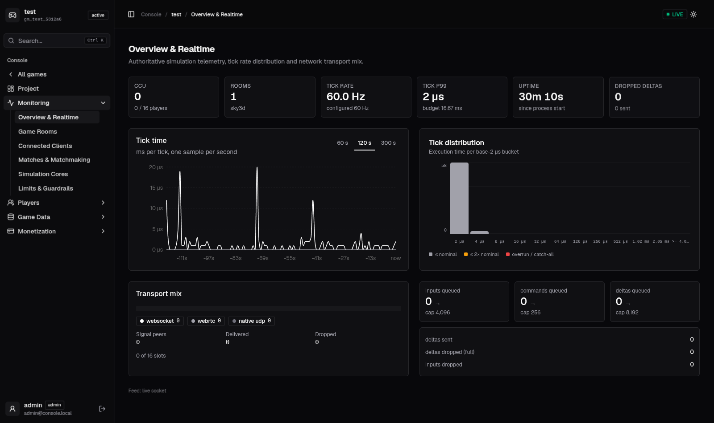
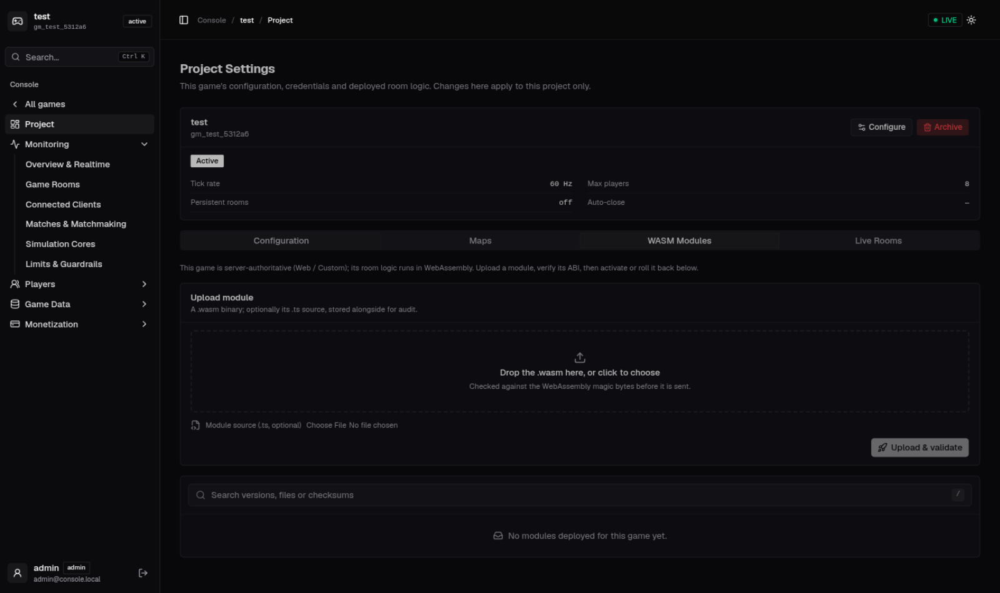

# CYG — the single-binary game server platform

An open-source multiplayer backend that does what Colyseus + Nakama do, in **one Rust binary**: authoritative WASM game rooms, WebRTC + UDP netcode, a player accounts/chat/friends/leaderboards API, and a web console to run it all — self-hosted, on a $10/mo VPS.

No Node cluster, no sidecar orchestra. `cyg run` **is** the production artifact. Everything below ships **in the box** — game runtime, physics, ECS, netcode, BaaS, console. There is nothing to bolt together.

```
┌──────────────────────────  one process  ──────────────────────────┐
│                                                                   │
│  Control plane (Tokio/Axum)          Game host loop (pinned sim)  │
│  ├─ matchmake + seat tokens          ├─ WASM room runtime         │
│  ├─ /ws/signal  (WebRTC signaling)   ├─ inbuilt ECS backend       │
│  ├─ /v2/* player API (BaaS)          ├─ Rapier2D/3D physics       │
│  ├─ /v2/console/* + web dashboard    ├─ AOI / spatial index       │
│  └─ statics (game website + SDK)     └─ WebRTC · UDP data plane   │
│                                                                   │
│            everything talks through one lock-free bus             │
└───────────────────────────────────────────────────────────────────┘
```

## See it

Every game is server-authoritative WebAssembly — and the console workspace around it is the same binary. Live telemetry of a WASM game (tick-time traces, tick distribution histogram, transport mix, queue depths — one live WebSocket feed, scoped to this game only):



The same game's Project tab: configure sync rate and capacity, deploy WASM room modules with an ABI gate, upload maps, watch live rooms — activate and rollback without touching the server:



## Highlights

- **Your game runs as sandboxed WebAssembly** — extend `Room`, get the full Colyseus-shaped lifecycle (`onAuth`/`onCreate`/`onJoin`/`onDrop`/`onReconnect`/`onLeave`/`onDispose` + shutdown and exception hooks, a `Client` handle in every hook), declare your state **and your input frame** in the schema, mutate a typed reactive state, `commitState()`. Zero-GC AssemblyScript, hot-reload on save, per-room sandbox: a trapping room fails alone — its crashes and bad memory accesses stay inside the room while the host keeps running.
- **The engine parts come to you — all inbuilt, all optional-per-game**: host-side Rapier2D/3D physics, deterministic RNG and tick timers, navmesh A* pathfinding, spatial AOI, lag-compensated raycasts. Thirty-plus `sys_*` imports behind per-game permissions; your room code calls them like plain functions.
- **An inbuilt ECS backend for scale.** When a room fits the template shape (movement, dense players), the same binary can run it on the flat, cache-native ECS state instead of per-entity WASM — 128 Hz at thousands of CCU per core. Same wire protocol, same console, same descriptor; a room whose name contains `ecs` runs on it. Nothing extra to install.
- **WebRTC DataChannels** (dual lane: newest-wins deltas + ordered reliable) with raw-UDP native clients on the side — QUIC-tier reliability on both: per-frame sequence, reorder-safe delivery, SACK selective resends, sendmmsg + UDP-GSO fan-out.
- **Reactive client SDK** — descriptor-driven decode at join: `room.onStateChange`, `player.listen("x", cb)`, collection `onAdd/onRemove`, `room.request()` RPC, `client.auth`, `room.clock`. CYG-branded imports, no alien syntax.
- **BaaS in the same binary** — accounts (device/email/custom + link/unlink, MFA), friends, groups, chat, channels, parties, presence, storage, leaderboards, tournaments, IAP validation, inventory, notifications, matchmaker.
- **Web console** — per-game workspace: live telemetry, live rooms & clients, WASM studio (upload → ABI gate → activate → rollback), map upload (3D mesh / 2D arena / navmesh), matches with terminate, accounts with ban that kicks live sessions in realtime — and every view scoped to the game you opened.
- **Measured capacity** — the table below, all from this one binary.

## Quick start

**One line (Linux / macOS)** — installs the latest release binary:

```bash
curl -fsSL https://raw.githubusercontent.com/ananddub/cyg/main/scripts/install.sh | sh
```

Then scaffold and run:

```bash
cyg init my-game && cd my-game
cyg run
# console → http://localhost:8124/dashboard/
```

**Docker image** (self-contained, game included):

```bash
docker pull dubeyanand/cyg-gaming:v0.1.0
```

**From source** (the server with embedded SurrealDB, the repo is mounted live):

```bash
just up                 # start the stack with examples/sky3d
just status             # health of all containers
# console: http://localhost:19224/dashboard/   (admin / change-me in dev)
just game coin-rush     # run a different example
just down
```

Local, without Docker:

```bash
cargo build --release
CYG_ALLOW_DEFAULT_SECRETS=1 ./target/release/cyg run examples/coin-rush
# console  http://localhost:8124/dashboard/
```

Fresh project:

```bash
cyg init my-game && cd my-game
cyg doctor          # config + schema + ABI check
cyg run             # compile src/index.ts → wasm and serve
```

## Writing a game — every use case

`cyg init` scaffolds the modern layout; every snippet below is that syntax:

```
my-game/
├── config.toml            runtime: ports, tick rate, capacities, permissions
├── src/
│   ├── index.ts           your room logic (the entry config.source points at)
│   └── schema/            network state — one or more .ts files (player.ts, …)
├── pkg/                   server SDK, vendored: cyg-server.ts + cyg.d.ts + as-types.d.ts
├── gen/                   generated bindings (gitignored): cyg.schema.ts
├── out/                   build artifacts: cyg.schema.bin, room_logic.wasm
└── tsconfig.json          editor types (VSCode opens with zero errors)
```

Save `src/index.ts` or anything under `src/schema/` while `cyg run` is up and the room recompiles and hot-swaps — players stay connected. The browser SDK is served by the server itself at `/cyg.js`; nothing to copy. A deeper version of this tour ships in `docs/site/guide.html`.

### 1. config.toml

```toml
name = "my-game"
runtime = "assemblyscript"      # the standard path
source = "src/index.ts"        # room entry
out = "room_logic.wasm"

port = 7777                    # game data (WebRTC over UDP)
tick_rate = 30                 # 20 casual … 60/128 competitive
max_clients = 16
max_rooms = 1024
# room_options = '{ "map": "cs_assault" }'   # server defaults for onCreate —
# merged with the creator's joinOrCreate options (client keys win)

[control]
api_port = 8124                # matchmake, signaling, /v2, console, /cyg.js

[control.session]
database_endpoint = "surrealkv://data/cyg"   # embedded accounts/chat/leaderboards
```

The scaffolded config carries commented blocks for everything else — room lifetime (`[lifecycle]`: `room_max_seconds`, `reap_idle_secs`, `persistent_rooms`, drain grace), the guest watchdog (`[watchdog]`), gameplay event recording (`[gameplay]`), player quotas (`[control.quotas]`), IAP verification and social sign-in — each block documenting the shipped default. `cyg doctor` validates the whole project in one command.

### 2. Schema — declare the state once

`src/schema/player.ts` (the compiler scans `src/schema/*.ts`; `player.ts` is the conventional entry):

```ts
import { schema, t } from "cyg";

export const Player = schema({
    pid:   t.int64().default(0),    // player ids are i64
    x:     t.number().default(0),   // f64 — positions, angles
    y:     t.number().default(0),
    hp:    t.uint8().default(100),  // 1 byte on the wire — size matters at 128 Hz
    name:  t.string(),              // whatever the client sent in its join options
}, "Player");

export const PlayerSchema = Player;

export const State = schema({
    players: t.map(Player),         // the collection — keyed by entity id
}, "State");

// Typed join options (§3): client sends { name, team } — onJoin receives
// a typed instance. Strings OK here; the host does the encoding.
export const JoinOptions = schema({
    name: t.string(),
    team: t.uint8().default(0),
}, "JoinOptions");

// The per-tick input frame — declare YOUR fields (§5). Numeric/bool only.
export const Input = schema({
    moveX: t.f32().default(0),
    moveZ: t.f32().default(0),
    jump: t.boolean().default(false),
}, "Input");
```

Types: `t.number()/f64`, `f32`, `int8…int64`, `uint8…uint32`, `boolean`, `string`. Collections: `t.map(Entity)` (keyed), `t.array(Entity)` (ordered — chat log, bullet feed), `t.ref(Entity)` (entity reference). `.default(v)` works on primitives and strings. Reserved words cannot be field names; `Input` and `JoinOptions` are reserved (the input frame and the typed join options).

`cyg run` (or `cyg schema`) compiles this into three artifacts:

| Artifact | Consumed by |
|---|---|
| `gen/cyg.schema.ts` — typed classes (`Player`, `PlayerSchema`, `GameState`) + the `decodeInput`/`decodeJoinOptions` helpers when `Input`/`JoinOptions` defs exist | your room, via `import { … } from "../gen/cyg.schema"` |
| `out/cyg.schema.bin` — binary descriptor (state schemas + the input frame) | delivered to every client in the join handshake |
| `out/cyg.schema.d.ts` — browser type contract | editors and TS frontends |

Import the generated classes from `../gen/cyg.schema` — never import `src/schema/*` directly from the room (the `"cyg"` module only resolves inside the schema compiler).

### 3. The room — lifecycle, state, commit

Hooks receive a **`Client` handle** (Colyseus-shaped: `.id`, `.sessionId`, `.send`, `.sendText`, `.auth`, `.leave()`). The raw player id (`client.id`) works everywhere too — declare either style, the bridge matches.

```ts
// src/index.ts
import { Room, Client, SchemaState, Vec2, InputReader, CloseCode } from "../pkg/cyg-server";
import { Player, PlayerSchema, JoinOptions, decodeInput } from "../gen/cyg.schema";

export class MyGame extends Room {
    private state: SchemaState = new SchemaState(PlayerSchema);
    private players: Array<Player> = [];
    private moves: Map<i64, Vec2> = new Map<i64, Vec2>();
    private speed: f64 = 120.0;

    // config room_options ⊕ the creator's joinOrCreate options
    onCreate(max: i32, options: string): void {
        this.setState(this.state);              // bind — commitState() syncs this
    }

    // Validate and return auth data → arrives as onJoin's third arg. THROW to reject.
    onAuth(client: Client, options: string, context: string): string {
        return "{}";
    }

    // options: typed via the schema's JoinOptions def — no JSON parsing.
    // The room decides the spawn; the host never picks x/y.
    onJoin(client: Client, options: JoinOptions, auth: string): void {
        client.auth = auth;
        const id = client.id;
        const p = new Player();
        p.pid = id;
        p.name = options.name == "" ? "player " + id.toString() : options.name;
        p.x = 120.0 + (this.players.length % 8) * 70.0;
        p.y = 100.0 + ((this.players.length / 8) as i32) * 70.0;
        this.players.push(p);
        this.moves.set(id, new Vec2(0.0, 0.0));
        this.state.set(id as u32, p);           // add to the synced collection
        client.sendText("welcome", p.name);     // targeted — the Client handle
        this.broadcastText("joined", p.name, id);   // everyone except the joiner
    }

    // Connection dropped without consent — your window before the hold starts.
    onDrop(client: Client, code: i32): void {}

    // The player came back within the reconnection window.
    onReconnect(client: Client): void {}

    // code is a CloseCode: LEFT · KICKED · SERVER_SHUTDOWN · TIMED_OUT · LOST.
    // Anything but LEFT can be held for allowReconnection.
    onLeave(client: Client, code: i32): void {
        const id = client.id;
        this.state.delete(id as u32);           // drop from this.players/moves too
    }

    // The process is draining — one broadcast flush follows this call.
    onBeforeShutdown(): void {
        this.broadcastText("going-down", "Save your progress!");
    }

    // A guest call trapped (watchdog fuse or runtime error). Best effort.
    onUncaughtException(message: string, methodName: string): void {}

    onInputFrame(client: Client, f: Input): void {   // pre-decoded (§5)
        if (!this.moves.has(client.id)) return;
        this.moves.set(client.id, new Vec2(f.moveX, f.moveZ));
    }

    onTick(dt: f64): i64 {                      // dt in seconds — always scale by it
        for (let i = 0; i < this.players.length; i++) {
            const p = this.players[i];
            const move = this.moves.get(p.pid);
            p.x += move.x * this.speed * dt;
            p.y += move.y * this.speed * dt;
        }
        return this.commitState();              // dirty-only delta out
    }
}
```

**Lifecycle**, in the order a client moves through the room — `onAuth` → `onCreate` → `onJoin` → `onDrop`/`onReconnect` → `onLeave` → `onDispose`, plus `onBeforeShutdown` (drain) and `onUncaughtException` (watchdog). Every hook may take the raw `id: i64` instead of `client: Client` — declare whichever you prefer; hooks you don't declare are simply not wired.

Details worth knowing:

- **`onAuth`** returns any JSON (even `"{}"`); that string reaches `onJoin` as `auth` — read it with `jsonString(auth, "role", "player")`. Throwing rejects the join; so does a trap.
- **`onCreate` options** = the config's `room_options` (server defaults) overlaid with the creator's `joinOrCreate` options — client keys win.
- **`onDrop`** fires before the reconnection hold starts — message the others ("X is reconnecting…"). If the hold expires, `onLeave` fires with `CloseCode.TIMED_OUT`; `allowReconnection()` (return ms) controls the window.
- **`onLeave` codes**: `LEFT` (clean leave), `KICKED` (your room called `client.leave()`), `SERVER_SHUTDOWN` (drain), `TIMED_OUT`, `LOST`.
- **Broadcasts skip one player** with the third arg: `this.broadcastText("chat", text, senderId)`.
- **No `JoinOptions` def?** `onJoin(client, options: string)` receives the raw JSON — pull keys with `jsonString/jsonNumber/jsonBool`. Old rooms keep working unchanged.
- **Throttle** without touching `tick_rate`: `this.patchRate` (min ms between patches) and `this.simulationInterval` (min ms between `onTick` calls).

When the root carries scalars or several collections (`coinX`, `phase`, two maps), codegen emits a world class instead — same three lines, richer state:

```ts
import { GameState, Player } from "../gen/cyg.schema";

private s: GameState = new GameState();
onCreate(max: i32, options: string): void { this.setState(this.s); }
// s.players.set(id, p) · s.players.get(id) · s.players.delete(id) · s.players.ids
// s.coinX = 40.0 + rngNext() * 720.0 · s.phase = 2      (root scalars, synced the same way)
```

`commitState()` encodes only what changed — tagged TLV rows; a quiet room costs ~0 bytes. Clients receive one full snapshot at join and patches afterwards, decoded from the descriptor.

### 4. Deterministic helpers

None of these read the wall clock, so a replay re-simulates identically:

```ts
rngNext(): f64                       // 0..1 xorshift64, seeded per room
Random.seed(s: u64) / Random.nextU32()
clockTicks(): i64                    // the authoritative tick counter

Timers.set(id, delayTicks, intervalTicks = 0)   // 0 = one-shot
Timers.poll()                                  // call once per onTick → fired id (0 = none)
Timers.cancel(id)

Combat.applyDamage(…)                // zone-weighted damage + crits → DamageResult
MatchStateMachine / CooldownTracker / TriggerZone   // match flow, cooldowns, zones
```

Timers are polled, not callbacks — that is what makes them replay-safe.

### 5. Inputs — declare once, send objects

Movement input is **schema-declared**, like everything else. Add an `Input` def to your schema — your fields, numeric/bool, any shape your game needs (racing: `throttle`/`steer`; MOBA: `moveX`/`moveZ`/`skill`):

```ts
// src/schema/player.ts — same file as the state
export const Input = schema({
    moveX: t.f32().default(0),
    moveZ: t.f32().default(0),
    jump: t.boolean().default(false),
    skill: t.uint8().default(0),      // jo bhi chahiye — ye tumhara contract hai
}, "Input");
```

Codegen turns it into a typed decoder; the descriptor carries it to the client at join. Neither side ever packs a byte — the field order above **is** the wire order.

**Client** — send a plain object on the newest-wins unreliable lane:

```js
room.sendInput({ moveX: 1, moveZ: 0, jump: false, skill: 2 });

// ya keyboard handle — declared fields khud bharta hai:
const input = room.input();
const unbind = input.bindKeyboard();          // WASD + arrows + space
setInterval(() => input.send(), 33);
```

**Server** — the frame arrives **pre-decoded** (the bridge runs the generated decoder; you never see a reader):

```ts
onInputFrame(client: Client, f: Input): void {
    this.moves.set(client.id, new Vec2(f.moveX, f.moveZ));
    if (f.skill > 0) this.castSkill(client.id, f.skill);
}
```

Want raw control instead? Declare `onInputFrame(client: Client, r: InputReader)` and call the generated `decodeInput(r)` yourself — both styles work.

Stale frames are dropped for you (per-player seq, wrap-safe newest-wins) — a late packet never rewinds a player. Strings/arrays are not allowed in the input frame (fixed-size wire), and `Input` cannot double as a state entity; both are caught at `cyg schema` time. `room.sendInput(…)` accepts exactly the input object — the old positional `(flags, aimYaw, …)` form is gone.

**The lane rule:** everything you cannot afford to drop (fires, chats, RPCs, `onMessage` traffic) rides the **reliable ordered** lane via `room.send`. Per-tick movement and aim ride the unreliable input lane — newest-wins, no retransmit; a late movement packet is worthless by definition.

### 6. Messaging — broadcast, targeted, RPC

```ts
this.broadcast("phase", bytes);                // server → everyone (reliable)
this.broadcastText("chat", "welcome!");
this.sendTo(playerId, "private", bytes);       // server → one player
this.sendTextTo(playerId, "toast", "level up");

// ya the Client handle se (hooks jo client receive karte hain):
client.send("phase", bytes);
client.sendText("toast", "level up");
client.leave();                                // kick — room gets onLeave(id, CloseCode.KICKED)

this.onMessage("fire", (senderId, reader, room) => { /* typed app message */ });

this.onRequest("login", (senderId, reader, ctx) => {    // request/response RPC
    const payload = reader.remainingBytes();
    ctx.replyText("ok");                                // or ctx.reply(bytes)
});
```

Client side:

```js
room.onMessage("chat", (payload) => {});
room.onMessage("*", (type, payload) => {});        // wildcard
room.send("fire", { dir });                        // reliable, ordered
const res = await room.request("login", { user }); // RPC — 5 s timeout, promise
```

### 7. 2D physics — Rapier2D in the host

Physics runs host-side; the room only makes calls. With the batched ABI a whole room's velocities and position readbacks cross the wasm boundary in a handful of calls per tick — that is where the ~8k CCU/core @128 Hz figure below comes from:

```ts
import { Rapier2D, BodyType, Vec2, PhysicsBatch2D } from "../pkg/cyg-server";

private batch: PhysicsBatch2D = Rapier2D.batch(4096);   // keep for the room's lifetime

onCreate(max: i32): void {
    this.setState(this.s);
    Rapier2D.init(0.0, 0.0);                            // gravity (0,0 = top-down)
    this.coinBody = Rapier2D.createBody(BodyType.Fixed, 400, 250);
    Rapier2D.addCircleCollider(this.coinBody, 24.0, true, 0.0, 0.0);  // sensor = pickup
}

onJoin(id: i64, x: f64, y: f64): void {
    const body = Rapier2D.createBody(BodyType.Dynamic, x, y);
    Rapier2D.addCircleCollider(body, 14.0, false, 0.0, 0.0);
    this.bodies.set(id, body);
}

onTick(dt: f64): i64 {
    this.batch.begin();                                 // 1. queue velocities
    for (let i = 0; i < ids.length; i++) this.batch.pushVelocity(this.bodies.get(ids[i] as i64), vx, vy);
    this.batch.applyVelocities();                       //    ONE host call

    Rapier2D.step(dt);                                  // 2. advance the world

    this.batch.syncPositions(this.coinBody);            // 3. ONE readback call
    let slot = 0;
    for (/* same id order as the push loop */) {
        p.x = this.batch.x(slot); p.y = this.batch.y(slot);
        if (this.batch.hasContact(slot)) p.score += 10; // batched contact test
        slot++;
    }
    return this.commitState();
}
```

Single-body surface when you don't need the batch: `setVelocity / getVelocity / getPosition / setPosition / applyImpulse / checkContact(a, b) / removeBody / step(dt)`, colliders `addCircleCollider(body, radius, sensor, ox, oy)` and `addBoxCollider`. Arena walls ship as `arena_2d.json` (`{ arena_width, arena_height, obstacles: [{ x, y, w, h, rotation? }] }` — fixed colliders cloned into every room at boot) or as the same JSON uploaded from the console.

### 8. 3D — kinematic controller + Rapier3D

Two layers. **`Physics`** is the character controller over the loaded map — wall-sliding movement, raycasts, lag compensation:

```ts
import { Physics, Vec3 } from "../pkg/cyg-server";

const res = Physics.move(pos, vel, 0.5, dt);         // MoveResult: res.pos, res.isGrounded
const groundY = Physics.getSurfaceHeight(pos, 0.5);  // floors, ramps, stairs
const hit = Physics.raycast(origin, dir, 200.0);     // CCD — hit.point, hit.distance
const lag = Physics.lagRaycast(origin, dir, 200.0);  // rewinds to what the shooter saw
```

**`Rapier3D`** is the rigid-body layer — projectiles, debris, dynamic props. Vector-first API:

```ts
Rapier3D.init(new Vec3(0.0, -9.81, 0.0));
const bullet = Rapier3D.createBody(BodyType.Dynamic, spawnPos);
Rapier3D.addBallCollider(bullet, 0.1);
Rapier3D.setVelocity(bullet, new Vec3(dir.x * 60, dir.y * 60, dir.z * 60));
Rapier3D.step(dt);
const p = Rapier3D.getPosition(bullet);              // → Vec3
if (Rapier3D.checkContact(bullet, targetBody)) { /* damage */ }
Rapier3D.removeBody(bullet);
```

Rest of the surface: `getVelocity / setPosition / applyImpulse(impulse: Vec3) / addBoxCollider(body, halfExtents: Vec3)`, plus `Rapier3D.batch(maxBodies)` → `PhysicsBatch3D` for large rooms. `Physics` also has `*Raw` scalar variants as escape hatches. 3D maps: `cyg cook map.glb arena.oxcl` (GLB → OXCL collision mesh, instant boot) or hand-written `arena_map.json` boxes; console-uploaded maps win over local files.

### 9. Navmesh — bot pathfinding

```ts
import { NavMesh, Vec2 } from "../pkg/cyg-server";

const path: Vec2[] = NavMesh.findPath(botPos, targetPos, 32);
// corner waypoints — steer point-to-point, treat the last as "arrive"; [] = unreachable
```

Upload the baked navmesh (Polyanya `.nav2d` / `.mesh`) from the console (Project → Maps → Navmesh); the host injects it into every room. Nothing pathfinding-shaped runs in the guest.

### 10. AOI — area of interest

```ts
spatialUpdate(playerId, new Vec2(p.x, p.y));     // insert-or-move, once per tick when moving
const near = spatialQuery(new Vec2(x, y), 40.0, outIdsPtr);  // ids within R → count
spatialRemove(playerId, new Vec2(p.x, p.y));     // on leave — or the ghost lingers
```

With `x`/`y` fields in your schema and `[aoi] enabled = true`, the host can filter deltas automatically — entities outside a viewer's radius are simply not encoded for that viewer.

### 11. Client SDK (web) — the whole surface

```html
<script src="/cyg.js"></script>
```

```js
const client = new CYG.Client("http://localhost:8124");   // the control plane
const room = await client.joinOrCreate("game_room", { name: "miya", skin: "ninja" });
// options tumhara data hai — room ke onJoin ko wahi JSON milti hai
// also: client.join(name, options) · client.create(name, options) · client.joinById(id) · client.spectate(name)
// ROOM VARIANTS: [rooms.duo] filter_by=["region"] in config.toml splits joins
// into per-region rooms; variant max_clients/tick_rate/persistent override defaults.

// Room variants (Colyseus defineRoom parity) — declare [rooms.duo] in
// config.toml with filter_by = ["region"], and joins split by their options:
//   joinOrCreate("duo", { region: "mumbai" })  → the mumbai duo room
//   joinOrCreate("duo", { region: "delhi" })   → a different room
// Variant max_clients/tick_rate/persistent override the game defaults.

room.onStateChange((state) => draw(state.players.get(room.playerId)));

const cb = CYG.getStateCallbacks(room);          // Colyseus v5 callback API
cb.onAdd("players", (p, id) => p.listen("x", (v, prev) => move(id, v)));
cb.onRemove("players", (p, id) => despawn(id));
cb.listen("coinX", (v) => drawCoin(v));          // root scalars too

room.onError((code, msg) => {});                 // signals + built-in auto-reconnect
room.onLeave((code) => {});
room.onReconnect(() => {}); room.onDrop(() => {});

await client.auth.login(email, password);        // .device(id) · .register(…) · .provider(name, data)
                                                 // .gameCenter(cred) · .instantGame(sr) · .setToken(t)

room.clock.now(); room.clock.setTimeout(fn, ms); // server-clock aligned
room.ping((rttMs) => show(rttMs));

// Voice: attach the WebRTC mesh, publish the mic, pick a channel
const voice = room.attachVoice();
await voice.enable(await navigator.mediaDevices.getUserMedia({ audio: true }));
room.setVoiceTeam("red");                        // string or number — hashed on the wire
room.sendVoice(2, seq, ts, flags, opusFrame);    // 0=proximity · 1=global · 2=team-only · 3=whisper
room.setVoiceMuted(true);                        // server-side mic mute
room.setVoiceDeafened(false);                    // stop hearing everyone

new CYG.Inspector(room);                         // live state-inspector overlay (dev)
CYG.Storage.set("muted", true); CYG.Storage.get("muted", false);  // localStorage, JSON, ox_ prefix
room.leave(true);
```

**Voice channels.** `TeamOnly` reaches only peers with the same team label; `Proximity` attenuates by distance (default inverse, 1.5–25 m); `Global` covers the whole room. Team ids can be strings (`"red"`, `"squad-a"`) or numbers — the SDK hashes the label with FNV‑1a into a u32, so routing stays one integer compare per packet (pass `null` to leave the team). Godot is relay-only (`CYGVoice.is_supported()` is false — native WebRTC is unavailable on most export targets) and uses the same wire: `room.set_voice_team("red")`.

The schema descriptor arrives in the join handshake — no client codegen, ever. Typed bindings for engines that want them: `cyg schema-codegen --lang cs|gdscript|cpp|lua|all`.

### 12. Other engines and backends

- **Unity / Godot / Unreal / native** — sibling SDK repos mirror the same surface (join, state callbacks, messaging, RPC, auth, clock). A project with no `source` file boots in **Unity-relay mode** — C#-authoritative rooms, the server just relays.
- **ECS rooms** — a room whose name contains `ecs` runs on the flat inbuilt ECS backend: same wire protocol, same console, 128 Hz at thousands of CCU per core.
- **Room interfaces** — `cyg gen-interface` emits Lua/C/C++/Rust/C#/TS room interfaces.

## CLI

```
cyg init            [dir]   scaffold a project (src/index.ts + src/schema/ + pkg/ + gen/)
cyg run             [dir]   compile if needed, then serve (hot-swap on save)
cyg build | aot     [dir]   compile + AOT-precompile to native .cwasm (<1 ms cold start)
cyg schema          [dir]   compile the schema → gen/ bindings + out/ descriptor
cyg schema-codegen  [dir]   typed client bindings (--lang cs|gdscript|cpp|lua|all)
cyg schema-status   [dir]   show the compiled schema's versions and hashes
cyg doctor          [dir]   validate config, schema and ABI exports
cyg gen-interface   [dir]   C++/Rust/C#/AS/TS room interfaces
cyg cook <in.glb> <out.oxcl>  cook a 3D collision mesh for instant boot
cyg backup | restore [dir]  export/import a remote SurrealDB (gzip + sha256)
cyg migrate         [dir]   run DB schema migrations
cyg openapi                 emit the /v2 OpenAPI document
cyg secrets audit  [dir]    flag default/weak secrets
cyg config diff    <a> <b>  diff two console config exports
cyg rules check    --file … validate a rules/anti-cheat JSON
cyg logs tail      --token …  tail server logs via the console API
```

## Architecture

One process, one thread for the simulation, lock-free bus between planes:

| Crate | What it is |
|---|---|
| `engine-server` | the host loop: WASM runtime, rooms, inbuilt ECS backend, RUDP, schema deltas, AOI |
| `engine-api` | `/v2` player API + `/v2/console` + dashboard API (Axum, SurrealDB) |
| `engine-control` | binds the plane: seats, signaling hub, Agones lifecycle |
| `engine-net` | transports: WebRTC (str0m, sans-IO) + raw UDP, sendmmsg + UDP-GSO fan-out |
| `engine-webrtc-protocol` | the shared wire: event/ack frames, SACK, lane classification |
| `engine-voice` | voice mesh signaling, Opus relay, spatial + team/squad routing |
| `engine-wasm` | the guest ABI: linker, permissions, state (de)serialization |
| `engine-schema` | schema compiler + codegen (server TS + browser descriptor) |
| `engine-physics` | Rapier2D/3D worlds, OXCL cooked meshes, lag compensation |
| `engine-spatial` / `engine-nav` | AOI index / navmesh + A* |
| `engine-bus` | the cross-plane channels (inputs, deltas, reloads, kicks) |
| `engine-config` | config.toml → typed structs |
| `engine-agones` | GameServer lifecycle for Kubernetes fleets |

**One runtime, inbuilt backends.** Game logic always runs in the WASM sandbox. The *state and simulation* behind it has inbuilt options: the reactive schema state (custom games), the host-side physics family (Rapier2D/3D), or the flat ECS backend (template-scale games — any room with `ecs` in its name runs on it). Same binary, same wire protocol, same console; nothing to install.

**Transport.** Browsers dial WebRTC (`game-unreliable` for high-rate deltas, `game-reliable` for everything else; the signaling WebSocket is control-plane only). Native engines speak raw UDP on `:7778` — dual-lane with the same reliability wire. `cfg.port` is the real game-data port and what seats advertise.

**Observability.** The console streams live per-tick telemetry (tick wall-time
trace, base-2µs histogram, per-lane queue depths, transport mix, per-game
scoped). The simulation-stage span (average µs/tick inside the room-tick block)
and a Prometheus **`/metrics`** endpoint ship in the binary — point any
Prometheus scraper at it, no config. The same socket also carries the
database's own change feed (see [Realtime](#realtime-change-feed)), so account
views need no polling either.

**Tenancy.** The console and the database serve many games; each process hosts one. A game workspace shows only that game's data — telemetry is refused for any other tenant ("This server hosts 'X', not the requested game"), and database views filter by `game_id`. Bind a process with `game_id`/`game_key` in config.toml.

**Maps.** Upload an `.oxcl` cooked mesh, a 2D/3D arena JSON, or a navmesh per game from the console; the host loads the active versions at boot (over local files) and new rooms pick up a re-activated map live.

## Database

The account plane (`/v2/*`, `/ws`, the console API) runs on **SurrealDB**, and
the binary embeds it: `database_endpoint = "surrealkv://data/cyg"` in
`config.toml` keeps accounts, chat and leaderboards in a local directory, with
no separate service to install. Point the same key at `ws://host:8000` (or set
`SURREAL_ENDPOINT` plus `SURREAL_USER`/`SURREAL_PASS`) to run against a remote
SurrealDB instead — same binary, local or cloud.

### Memory (embedded)

SurrealKV sizes its memtable and block cache from the **host's** total memory:
on a 64 GiB machine it reserves up to 4 GiB + ~43 GiB of capacity, which no
small deployment can hold. Two keys pin it instead:

```toml
[control.session]
database_memtable_mib = 64   # largest memtable before a flush
database_cache_mib = 32      # block cache capacity
```

Together they cap the engine's data memory at 96 MiB, which is what lets the
whole process fit a 500 MB container. Both are ceilings rather than
reservations (the memtable grows with writes, the cache with reads), a single
transaction cannot exceed the memtable, and `0` restores host-derived sizing.
They reach the engine through the datastore builder (`crates/engine-api/src/db/exec.rs`),
and the startup log prints both the configured values and the bytes SurrealKV
reports applying.

### Schema and repositories

Records are `#[derive(SurrealRecord)]` structs in
`crates/engine-api/src/repositories/models.rs`; the server creates the tables and
indexes it needs at boot. Queries are hand-written SurrealQL in
`crates/engine-api/src/repositories/`, executed through the single `Datastore`
handle (`crates/engine-api/src/db/`) so embedded engines hold exactly one
connection. Console services read/write through `state.q`; multi-statement
transactions stay hand-written beside their services by convention. Adding a
domain = add the record, its queries, and call them from the service.

### Blobs (uploads)

Uploaded WASM room modules and map assets are **not** stored in table rows. Each
row keeps only identity and metadata (`filename`, `format`, `sha256`,
`size_bytes`, version, `is_active`, `source_code`, `blob_key`); the payload goes
to a blob store under keys `wasm/{game_id}/{version}.wasm` and
`maps/{game_id}/{version}.{format}`. `[control.session] blobs` selects it:

| `blobs` | Under `mem://` | Under `surrealkv://` | Under a remote endpoint |
|---|---|---|---|
| empty (default) | Surreal `memory://` bucket | `data/uploads` on disk | unset — uploads answer 503 |
| `file:data/uploads` (or `file:///abs/path`) | disk | disk | disk |
| `memory://`, `s3:/bucket?…`, `gs:`, `az:` | Surreal bucket | Surreal bucket | Surreal bucket |

`file:` is served by the process's own atomic writer; every other value becomes
a `DEFINE BUCKET blobs BACKEND <url>` in the datastore and is read back with
`file::*`. The S3/R2 form is `s3:/bucket?region=…&prefix=…&access_key=…&secret_key=…`
(note the single slash — it is not `s3://bucket/prefix`). Buckets are an
experimental SurrealDB feature: a **remote** server must be started with
`--allow-experimental files`, and `file:` backends additionally need
`SURREAL_BUCKET_FOLDER_ALLOWLIST`. An in-process `memory://` bucket is empty
after a restart and per-process — use `s3:` or a shared `file:` path for
multi-replica deployments.

The host loop runs the game's **active** module from the console: the control
plane fetches it at boot and every upload/activation publishes the version's
bytes on the reload bus, so live rooms hot-swap onto them after a SHA-256 check
against the row. The project folder's compiled `room_logic.wasm` is the
fallback when no module has been uploaded.

### Realtime (change feed)

Console views do not poll the database for account rows. SurrealDB's
`LIVE SELECT` runs inside the datastore and pushes changes to `/ws/dashboard`
as `live` frames — `{ "type": "live", "topic", "action", "record", "seq" }`.
The frame is an invalidation, never a row: a view that cares refetches what it
shows, so large payloads stay off the wire. One live query runs per
`(topic, game)` and every dashboard socket of that game shares it; when the
last socket closes the stream is dropped, which kills the query — writes cost
nothing extra while nobody is watching. A client that falls behind gets one
`resync` event instead of silently missing changes.

Topics are closed and server-side (`crates/engine-api/src/infra/realtime.rs`):
a socket names one of `users`, `purchases`, `subscriptions`, `wallet_ledger` or
`leaderboard` for its own game, never a table or a filter, so a subscription
cannot widen past its tenant — and an unscoped socket (tooling, no `game_id`)
receives telemetry only. The scoped socket opens all five feeds, so an account
edit, an in-app purchase, a subscription renewal, a wallet change and a
leaderboard submit each reach the open console. It works on both engine shapes,
the embedded ones included.

Player rows carry the tenant directly; store rows (`purchase`, `subscription`,
`wallet_ledger`) copy it from the account that owns them at write time. Rows
written before tenancy are claimed by the first boot that resolves the game
(`services/games/tenant.rs`), accounts first, so the feeds are complete without
a manual migration.

The console turns each frame into a cache invalidation, trailing-debounced by
300 ms (`dashboard/src/pages/console.tsx`), so a bulk import or a wallet sync
costs one refetch and a closed view costs none. Live telemetry (overview, tick
series) rides the same socket at 1 Hz; the room, client and worker lists are a
separate read that polls every 5 s.

## Benchmarks (measured in a 2-core / 2 GB sandbox cgroup, release builds — published figures rounded below measured)

The same room runtime, scaled by which inbuilt backend carries the simulation — heavier custom logic, lighter template logic:

| Inbuilt backend / workload | p99 tick | CCU per core |
|---|---|---|
| WASM room, full combat logic (move + shoot + damage + respawn) @60 Hz | 4.1 ms @500p | ~1.5k |
| WASM room + inbuilt Rapier2D @128 Hz, 100–200p rooms | 0.07 ms @100p | ~7k |
| Inbuilt ECS backend (movement) @128 Hz | 0.06 ms @100p | ~10k |

### Measured CCU curve (1-core pinned, every player moving, full pipeline)

Per-player cost bends with room size — 0.5 µs/player at 100 players grows to
~1.75 µs at 1,200 (solver density, per-tick state encode, cache pressure) — so
one headline number hides the shape. These are sustained, measured at each
room size, then rounded **below** the measurement:

| Workload | @30 Hz | @60 Hz | @128 Hz |
|---|---|---|---|
| WASM + Rapier2D (batched ABI), 10-player rooms, 100–200 rooms/core | ~30k | ~15k | ~8k |
| WASM + Rapier2D (batched ABI), one 1,200-player room | — | ~7k | ~4k |
| WASM + Rapier3D (batched ABI, sky3d room) | — | ~2.5k | ~1k |
| Native ECS backend (movement) | — | ~20k | ~10k |

Reproduce: `cargo run --release --example bench_small_rooms` /
`bench_wasm_rapier_128` / `bench_wasm_rapier3d_128` / `bench_ecs_128` (under
`taskset -c 0`). 2-core / 2 GB pod @128 Hz: 100 rooms × 100 players fits at
0.76× the tick budget, peak RAM 93 MB.

### Peak memory (`memory.peak`)

`scripts/memory-bench.sh` boots the release binary inside its own cgroup v2
scope and reads the kernel's figure, so nothing is estimated or sampled:

```bash
cargo build --release
scripts/memory-bench.sh                          # db off + db on, 500 MiB cap, one CPU
scripts/memory-bench.sh --scenario on --json
scripts/memory-bench.sh --limit-mib 256 --settle 30
```

The room is the tracked AssemblyScript fixture, precompiled with `cyg-game
build` before the clock starts, so the sample is a normal boot (AOT load, no
compile). Each scenario gets a fresh scope (`MemoryMax`, `MemorySwapMax=0`,
`AllowedCPUs`) and reports `memory.peak`, anonymous memory at settle time, the
measured tick rate from `/metrics`, and the scope's `oom_kill` count; a run
that trips the cap exits non-zero. Without a user systemd session it falls back
to `VmHWM`/`VmRSS` and says so.

| scenario | peak | steady (anon) | tick-Hz | oom_kill |
|---|---|---|---|---|
| db off | 21.7 MiB | 17.4 MiB | 30.92 | 0 |
| db on, `surrealkv://`, 64/32 MiB | 144.6 MiB | 86.2 MiB | 29.86 | 0 |

Measured on Linux 7.2 pinned to one CPU, empty room. `peak` covers the whole run
including boot, so it is the number to budget against — SurrealKV's arenas
account for the headroom above steady. `steady` is anonymous memory (what the
process cannot hand back; the KV's file-backed pages are reclaimable), and a
real game adds its own state on top. Peaks repeat within a few percent; the
settle-time figure moves more as the allocator releases the boot spike.

## Testing

```bash
cargo test --workspace              # engine crates + API suite
(cd sdk/client/web && node test/schema.test.mjs && node test/signal.test.mjs \
  && node test/extras.test.mjs && node test/input.test.mjs)   # client SDK
node tests/e2e/input_lane_e2e.mjs   # schema input lane, live server + real SDK
just doctor sky3d                   # project-level health check
```

## Releases & SDKs

- **Binaries** — Linux / Windows / macOS (Intel + Apple Silicon) attach to every
  GitHub Release. One-line install above.
- **Docker** — `dubeyanand/cyg-gaming` on Docker Hub (game included, scratch-slim
  variant available).
- **SDK repos** — [cyg-unity](https://github.com/ananddub/cyg-unity) ·
  [cyg-godot](https://github.com/ananddub/cyg-godot) ·
  [cyg-unreal](https://github.com/ananddub/cyg-unreal) ·
  [cyg-native](https://github.com/ananddub/cyg-native) ·
  [cyg-web](https://github.com/ananddub/cyg-web) (npm: `cyg-client`).
  Development sources live in `sdk/client/` here.

## Repository layout

```
crates/            the engine (see table above)
src/main.rs        the `cyg-game` CLI
dashboard/         the web console (React, served by the binary at /dashboard/)
sdk/client/        web (cyg.js) + Unity/Unreal/Godot/native players
sdk/server/        AssemblyScript server SDK (cyg-server.ts — what pkg/ vendors)
examples/          sky3d, blaster, coin-rush, orbioo-agario, tank-3d — complete runnable games
docs/site/         the landing + A-to-Z guide this README condenses
docs/screenshots/  console captures used by this README
deploy/            Dockerfile + compose for the game container
ROADMAP-DX.md      the working roadmap (where the project is heading)
```

## License

Apache-2.0
