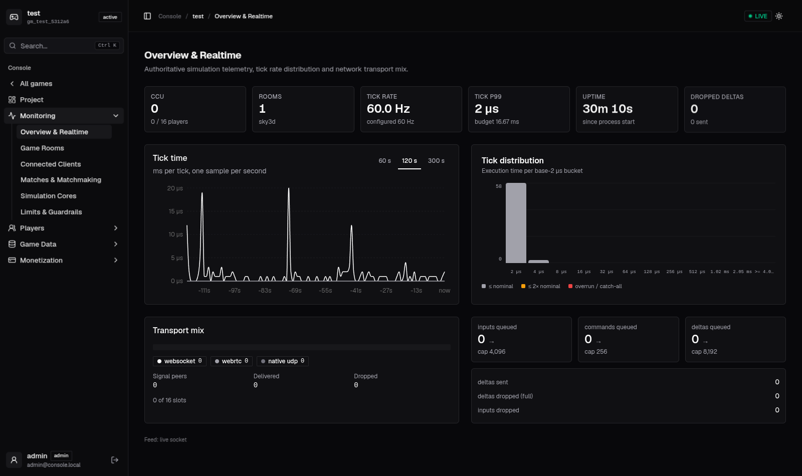
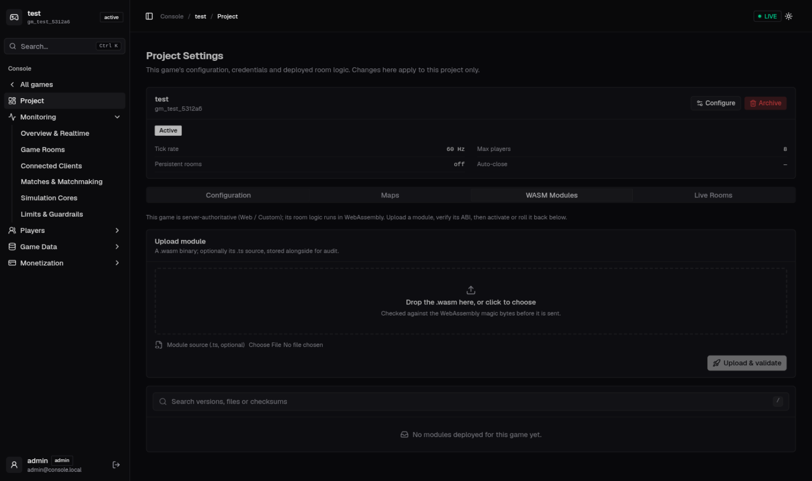

# CYG — the single-binary game server platform

An open-source multiplayer backend that does what Colyseus + Nakama do, in **one Rust binary**: authoritative WASM game rooms, WebRTC + UDP netcode, a player accounts/chat/friends/leaderboards API, and a web console to run it all — self-hosted, on a ₹800/mo VPS.

No Node cluster, no sidecar orchestra. `ox-game run` **is** the production artifact. Everything below ships **in the box** — game runtime, physics, ECS, netcode, BaaS, console. There is nothing to bolt together.

```
┌──────────────────────────  one process  ──────────────────────────┐
│                                                                   │
│  Control plane (Tokio/Axum)          Game host loop (pinned sim)  │
│  ├─ matchmake + seat tokens          ├─ WASM room runtime         │
│  ├─ /ws/signal  (WebRTC signaling)   ├─ inbuilt ECS backend       │
│  ├─ /v2/* player API (BaaS)          ├─ Rapier2D/3D physics       │
│  ├─ /v2/console/* + web dashboard    ├─ AOI / spatial index       │
│  └─ statics (game website + SDK)     └─ WebRTC · UDP data plane   │
│                                                                   │
│            everything talks through one lock-free bus             │
└───────────────────────────────────────────────────────────────────┘
```

## See it

Every game is server-authoritative WebAssembly — and the console workspace around it is the same binary. Live telemetry of a WASM game (tick-time traces, tick distribution histogram, transport mix, queue depths — one live WebSocket feed, scoped to this game only):



The same game's Project tab: configure sync rate and capacity, deploy WASM room modules with an ABI gate, upload maps, watch live rooms — activate and rollback without touching the server:



## Highlights

- **Your game runs as sandboxed WebAssembly** — extend `Room`, mutate a typed reactive state, `commitState()`. Zero-GC AssemblyScript, hot-reload on save, per-room sandbox: a trapping room fails alone — its crashes and bad memory accesses stay inside the room while the host keeps running.
- **The engine parts come to you — all inbuilt, all optional-per-game**: host-side Rapier2D/3D physics, deterministic RNG and tick timers, navmesh A* pathfinding, spatial AOI, lag-compensated raycasts. Thirty-plus `sys_*` imports behind per-game permissions; your `room.ts` calls them like functions.
- **An inbuilt ECS backend for scale.** When a room fits the template shape (movement, dense players), the same binary can run it on the flat, cache-native ECS state instead of per-entity WASM — 128 Hz at thousands of CCU per core. Same wire protocol, same console, same descriptor; a room whose name contains `ecs` runs on it. Nothing extra to install.
- **WebRTC DataChannels** (dual lane: newest-wins deltas + ordered reliable) with raw-UDP native clients on the side — QUIC-tier reliability on both: per-frame sequence, reorder-safe delivery, SACK selective resends, sendmmsg + UDP-GSO fan-out.
- **Reactive client SDK** — descriptor-driven decode at join: `room.onStateChange`, `player.listen("x", cb)`, collection `onAdd/onRemove`, `room.request()` RPC, `client.auth`, `room.clock`. Colyseus-shaped, no alien syntax.
- **BaaS in the same binary** — accounts (device/email/custom + link/unlink, MFA), friends, groups, chat, channels, parties, presence, storage, leaderboards, tournaments, IAP validation, inventory, notifications, matchmaker.
- **Web console** — per-game workspace: live telemetry, live rooms & clients, WASM studio (upload → ABI gate → activate → rollback), map upload (3D mesh / 2D arena / navmesh), matches with terminate, accounts with ban that kicks live sessions in realtime — and every view scoped to the game you opened.
- **Measured capacity** — the table below, all from this one binary.

## Quick start

**One line (Linux / macOS)** — installs the latest release binary:

```bash
curl -fsSL https://raw.githubusercontent.com/ananddub/cyg/main/scripts/install.sh | sh
```

Then scaffold and run:

```bash
cyg-gaming init my-game && cd my-game
cyg-gaming run
# console → http://localhost:8124/dashboard/
```

**Docker image** (self-contained, game included):

```bash
docker pull dubeyanand/cyg-gaming:v0.1.0
```

**From source** (Postgres + Redis + the server, the repo is mounted live):

```bash
just up                 # start the stack with examples/sky3d
just status             # health of all containers
# console: http://localhost:19224/dashboard/   (admin / change-me in dev)
just game coin-rush     # run a different example
just down
```

Local, without Docker:

```bash
cargo build --release
OX_ALLOW_DEFAULT_SECRETS=1 ./target/release/cyg-gaming run examples/coin-rush
# console  http://localhost:8124/dashboard/
```

Fresh project:

```bash
ox-game init my-game && cd my-game
ox-game doctor          # config + schema + ABI check
ox-game run             # compile room.ts → wasm and serve
```

## Writing a game

A project is `config.toml`, your room source and schema (`src/` in the examples; `ox-game init` scaffolds the same files at the project root), a `website.html` you host yourself, and generated `out/`. The server reads **only** what the config names — ports, tick rate, file paths — nothing is hardcoded.

```toml
name = "coin-rush"
runtime = "assemblyscript"
source = "src/room.ts"
out = "out/room_logic.wasm"
port = 7779            # game data (WebRTC over UDP)
tick_rate = 128
max_clients = 16

[control]
api_port = 8124        # matchmake, signaling, console, dashboard

[control.session]
database_url = "postgresql://…"
```

`src/schema.ts` declares the state; codegen emits the typed server classes and the browser descriptor:

```ts
// schema.ts
const Player = schema({ pid: t.int64(), x: t.number(), y: t.number(), score: t.number() }, "Player");
export const State = schema({
    players: t.map(Player),
    coinX: t.number(),
    coinY: t.number(),
}, "State");
```

`src/room.ts` is Colyseus-shaped — physics and input helpers included, no byte wrangling:

```ts
export class CoinRush extends Room {
    onCreate(max: i32): void { this.setState(this.s); Rapier2D.init(0.0, 0.0); /* … */ }
    onInputPacket(id: i64, input: InputReader): void {
        if (isHeld(input.readU8(), Key.W)) { /* move via Rapier2D, mutate s.players */ }
    }
    onTick(dt: f64): i64 { /* … */ return this.commitState(); }
}
```

The browser client needs no codegen — the descriptor arrives at join:

```js
const client = new CYG.Client(location.origin);
const room = await client.joinOrCreate("game_room");
room.onStateChange((state) => render(state.players.get(room.playerId).x));
callbacks.onAdd("players", (player) => player.listen("score", (v) => hud(v)));
const reply = await room.request("login", { user });   // request/response RPC
```

## CLI

```
ox-game init            [dir]   scaffold a project (room.ts + schema.ts + SDK)
ox-game run             [dir]   compile if needed, then serve
ox-game aot             [dir]   precompile to native .cwasm (<1 ms cold start)
ox-game schema          [dir]   compile schema.ts → server bindings + client descriptor
ox-game schema-codegen  [dir]   typed client bindings (--lang cs|gdscript|cpp|lua|all)
ox-game doctor          [dir]   validate config, schema and ABI exports
ox-game gen-interface   [dir]   C++/Rust/C#/AS/TS room interfaces
ox-game cook <in.glb> <out.oxcl>  cook a 3D collision mesh for instant boot
```

## Architecture

One process, one thread for the simulation, lock-free bus between planes:

| Crate | What it is |
|---|---|
| `engine-server` | the host loop: WASM runtime, rooms, inbuilt ECS backend, RUDP, schema deltas, AOI |
| `engine-api` | `/v2` player API + `/v2/console` + dashboard API (Axum, sqlx) |
| `engine-control` | binds the plane: seats, signaling hub, Agones lifecycle |
| `engine-net` | transports: WebRTC (str0m, sans-IO) + raw UDP, sendmmsg + UDP-GSO fan-out |
| `engine-webrtc-protocol` | the shared wire: event/ack frames, SACK, lane classification |
| `engine-wasm` | the guest ABI: linker, permissions, state (de)serialization |
| `engine-schema` | schema compiler + codegen (server TS + browser descriptor) |
| `engine-physics` | Rapier2D/3D worlds, OXCL cooked meshes, lag compensation |
| `engine-spatial` / `engine-nav` | AOI index / navmesh + A* |
| `engine-bus` | the cross-plane channels (inputs, deltas, reloads, kicks) |
| `engine-config` | config.toml → typed structs |
| `engine-agones` | GameServer lifecycle for Kubernetes fleets |

**One runtime, inbuilt backends.** Game logic always runs in the WASM sandbox. The *state and simulation* behind it has inbuilt options: the reactive schema state (custom games), the host-side physics family (Rapier2D/3D), or the flat ECS backend (template-scale games — any room with `ecs` in its name runs on it). Same binary, same wire protocol, same console; nothing to install.

**Transport.** Browsers dial WebRTC (`game-unreliable` for high-rate deltas, `game-reliable` for everything else; the signaling WebSocket is control-plane only). Native engines speak raw UDP on `:7778` — dual-lane with the same reliability wire. `cfg.port` is the real game-data port and what seats advertise.

**Observability.** The console streams live per-tick telemetry (tick wall-time
trace, base-2µs histogram, per-lane queue depths, transport mix, per-game
scoped). The simulation-stage span (average µs/tick inside the room-tick block)
and a Prometheus **`/metrics`** endpoint ship in the binary — point any
Prometheus scraper at it, no config.

**Tenancy.** The console and the database serve many games; each process hosts one. A game workspace shows only that game's data — telemetry is refused for any other tenant ("This server hosts 'X', not the requested game"), and database views filter by `game_id`. Bind a process with `game_id`/`game_key` in config.toml.

**Maps.** Upload an `.oxcl` cooked mesh, a 2D/3D arena JSON, or a navmesh per game from the console; the host loads the active versions at boot (over local files) and new rooms pick up a re-activated map live.

## Database

Postgres today. **SQLite support is on the roadmap as an embedded mode** —
FlashORM (the generator) already speaks SQLite, so a solo-dev "no Postgres
needed" build is planned; production/SaaS deployments stay on Postgres.

### FlashORM

Schema lives in `db/schema/*.sql`, named queries in `db/queries/*.sql`; `flash gen` emits typed repositories into `crates/engine-api/src/repositories/` (runtime-checked, no live DB needed at build). Console services read/write through `state.q`; multi-statement transactions stay hand-written beside their services by convention. Adding a domain = write the `.sql`, run `flash gen`, call `state.q`.

## Benchmarks (measured in a 2-core / 2 GB sandbox cgroup, release builds — published figures rounded below measured)

The same room runtime, scaled by which inbuilt backend carries the simulation — heavier custom logic, lighter template logic:

| Inbuilt backend / workload | p99 tick | CCU per core |
|---|---|---|
| WASM room, full combat logic (move + shoot + damage + respawn) @60 Hz | 4.1 ms @500p | ~1.5k |
| WASM room + inbuilt Rapier2D @128 Hz, 100–200p rooms | 0.07 ms @100p | ~7k |
| Inbuilt ECS backend (movement) @128 Hz | 0.06 ms @100p | ~10k |

2-core / 2 GB pod @128 Hz: 100 rooms × 100 players fits at 0.76× the tick budget, peak RAM 93 MB. Reproduce: `cargo run --release --example bench_ecs_128` / `bench_wasm_rapier_128` / `bench_potential` (under `taskset -c 0-1`).

## Testing

```bash
cargo test --workspace              # engine crates + API suite
node --test sdk/client/web/test/    # client SDK (schema decode, signaling, RPC)
just doctor sky3d                   # project-level health check
```

## Releases & SDKs

- **Binaries** — Linux / Windows / macOS (Intel + Apple Silicon) attach to every
  GitHub Release. One-line install above.
- **Docker** — `dubeyanand/cyg-gaming` on Docker Hub (game included, scratch-slim
  variant available).
- **SDK repos** — [cyg-unity](https://github.com/ananddub/cyg-unity) ·
  [cyg-godot](https://github.com/ananddub/cyg-godot) ·
  [cyg-unreal](https://github.com/ananddub/cyg-unreal) ·
  [cyg-native](https://github.com/ananddub/cyg-native) ·
  [cyg-web](https://github.com/ananddub/cyg-web) (npm: `cyg-client`).
  Development sources live in `sdk/client/` here.

## Repository layout

```
crates/            the engine (see table above)
src/main.rs        the `ox-game` CLI
dashboard/         the web console (React, served by the binary at /dashboard/)
sdk/client/        web (cyg.js) + Unity/Unreal/Godot/native players
sdk/server/        AssemblyScript (cyg-server.ts) + Lua/C/C++/Rust/C#/TS interfaces
examples/          sky3d, blaster, coin-rush — complete runnable games
docs/screenshots/  console captures used by this README
db/                schema + FlashORM queries
deploy/            Dockerfile + compose for the game container
ROADMAP-DX.md      the working roadmap (where the project is heading)
```

## License

Apache-2.0
