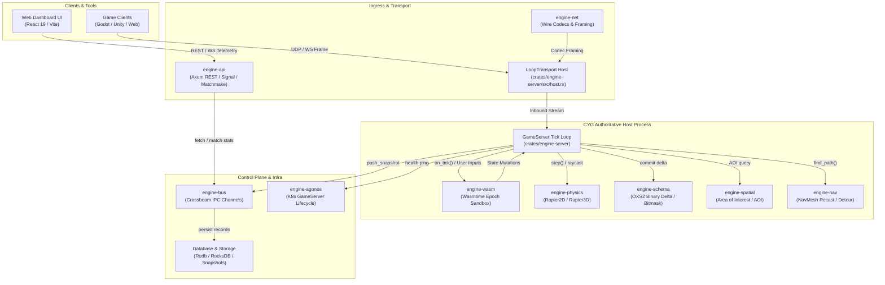
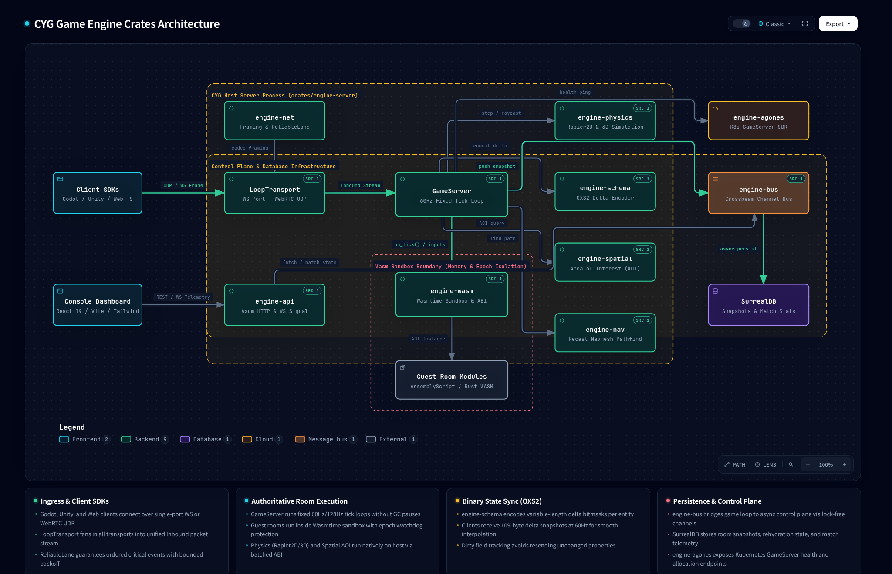

# CYG Engine: Full Crates Architecture & System Design

Is document me CYG / CYG game engine ke har crate ki responsibility, execution lifecycle, networking model, aur data flow ka complete technical breakdown diya gaya hai.

### Architecture Views
- **Static High-Res PNG (Instant, No Scripts)**: [crates-architecture.png](file:///mnt/SSD/Devloper/pannel/openoxide-gaming/docs/desing_crates/crates-architecture.png)
- **Static Visual Contact Sheet**: [crates-architecture.visual-check.html](file:///mnt/SSD/Devloper/pannel/openoxide-gaming/docs/desing_crates/crates-architecture.visual-check.html)
- **Interactive Deep-Link Viewer**: [crates-architecture.html](file:///mnt/SSD/Devloper/pannel/openoxide-gaming/docs/desing_crates/crates-architecture.html)

---

## Architecture Diagram (Mermaid)



---

## High-Resolution Static Diagram



---

## 1. Crates Map & Responsibilities

Monorepo ke andar har crate ek specific responsibility ke liye decoupled aur modular banaya gaya hai:

```
crates/
├── engine-core/          # Common traits, identifiers, timestamps, math types
├── engine-config/        # TOML configuration parsing (GameConfig, limits, ports)
├── engine-net/           # Wire codecs, framing, reliable channel, close codes
├── engine-webrtc-protocol# Low-level WebRTC DataChannel SDP/ICE signaling
├── engine-schema/        # OXS2 binary delta encoding & dirty bitmask change detection
├── engine-physics/       # Rapier2D & Rapier3D integration, lag-compensated raycasts
├── engine-spatial/       # 2D/3D Area of Interest (AOI) spatial hashing & radius queries
├── engine-nav/           # Recast & Detour navmesh pathfinding for game AI
├── engine-voice/         # WebRTC spatial voice channels
├── engine-wasm/          # Wasmtime runtime embedding, AOT (.cwasm), host-guest ABI
├── engine-bus/           # Lock-free inter-thread crossbeam channels (Server <-> DB <-> API)
├── engine-server/        # LoopTransport (WS/WebRTC fan-in), GameServer authoritative loop
├── engine-api/           # Axum HTTP REST, /ws/signal, JWT authentication, matchmaking
├── engine-agones/        # Kubernetes Agones game server lifecycle SDK
└── engine-dashboard/    # Embedded React 19 / Tailwind web console assets
```

---

## 2. Layer-by-Layer Architecture

### Layer 1: Client SDKs & Ingress
- **Client SDKs (`sdk/client/`):**
  - Godot 4.x (`sdk/client/godot/addons/cyg/`): GDScript native client connecting over WebSocket or WebRTC DataChannels.
  - Unity / C# (`sdk/client/unity/`): C# native async client.
  - Web Browser (`sdk/client/js/`): TypeScript client using browser native `RTCPeerConnection` and `WebSocket`.
- **Matchmaking & Auth:**
  - Client sabse pehle `engine-api` par `POST /matchmake` request karta hai.
  - Server HMAC-signed seat reservation token generate karke return karta hai.
- **Fan-in Ingress ([LoopTransport](file:///mnt/SSD/Devloper/pannel/openoxide-gaming/crates/engine-server/src/host.rs#L69)):**
  - Ek common port (`ws_port`) par WebSocket connections accept hote hain.
  - Dedicated UDP ports par WebRTC DataChannels (`udp://0.0.0.0:7777`) aur raw native UDP (`udp://0.0.0.0:7778`) listen hote hain.
  - [LoopTransport](file:///mnt/SSD/Devloper/pannel/openoxide-gaming/crates/engine-server/src/host.rs#L69) in sabhi transport channels ke incoming packets ko unified `Inbound` event stream me convert karke game loop ko deta hai.

---

### Layer 2: Authoritative Server Loop & Room Lifecycle
- **[GameServer](file:///mnt/SSD/Devloper/pannel/openoxide-gaming/crates/engine-server/src/host.rs#L100):**
  - Pure Rust me likha authoritative tick loop (60Hz / 128Hz).
  - Kisi bhi V8 Garbage Collector (GC) ya Node.js event loop lag ke bina microsecond-level timing execute karta hai.
- **Room Lifecycle Hooks:**
  - `on_join(session_id)`: Naye player ka registration aur initial state hydration.
  - `on_tick(delta_ms)`: Per-tick simulation execution.
  - `on_leave(session_id)`: Player disconnect handling ya reconnection seat hold (10 seconds timeout).
  - `on_save()`: Persistent room state serialization.
  - `on_dispose()`: Room release and resource reclamation.

---

### Layer 3: WebAssembly (WASM) Sandbox
- **[WasmHost](file:///mnt/SSD/Devloper/pannel/openoxide-gaming/crates/engine-wasm/src/abi.rs#L70) ([engine-wasm](file:///mnt/SSD/Devloper/pannel/openoxide-gaming/crates/engine-wasm)):**
  - Wasmtime engine use karke user rooms (`coin-rush` etc.) ko secure sandbox me execute karta hai.
  - Gameplay developers AssemblyScript (TypeScript-like) ya Rust me rooms likhte hain jo compile hokar precompiled AOT (`.cwasm`) modules bante hain.
  - **Watchdog Protection:** Epoch-based watchdog ticker infinite loops (`while(true)`) ko kill karta hai taaki server hang na ho.
- **Batched Host ABI:**
  - Guest ko native Rapier physics calls karne ke liye per-body context switch nahi karna padta.
  - `sys_rapier2d_set_velocities` aur `sys_rapier2d_get_positions` ke zariye poore world ka state single memory scratchpad se batch me transfer hota hai.

---

### Layer 4: State Synchronization & OXS2 Protocol
- **[engine-schema](file:///mnt/SSD/Devloper/pannel/openoxide-gaming/crates/engine-schema):**
  - Dirty property bitmasking use karta hai.
  - Sirf wahi fields wire par serialize hoti hain jo pichle tick se badli hon.
  - Har tick par 109-byte ke compressed delta packets 60Hz rate par clients ko stream hote hain.

---

### Layer 5: Message Bus & Persistence
- **[engine-bus](file:///mnt/SSD/Devloper/pannel/openoxide-gaming/crates/engine-bus):**
  - High-frequency game loop ko slow database queries se protect karta hai.
  - Lock-free memory channels (`snapshots_tx`, `fetches_rx`, `ownership_rx`) ke zariye control plane se communicate karta hai.
- **SurrealDB:**
  - Embedded ya distributed multi-model database.
  - Tables:
    - `room_snapshots`: Room state binary snapshots for crash rehydration and live migration.
    - `matches`: Match outcomes, peak player counts, duration, and end reasons.
    - `room_registry`: Active node leases and heartbeats.

---

## 3. End-to-End Tick Lifecycle

```
[Client Input] -> [LoopTransport (WS/WebRTC)] 
                      ↓
               [GameServer Loop]
                      ↓
           [engine-wasm (on_tick)] ──(Batched ABI)──> [engine-physics (Rapier)]
                      ↓                                       ↓
           [engine-schema (OXS2)] <────────────────────────────┘
                      ↓ (Delta broadcast)
              [Clients (60Hz)]
                      ↓ (Periodic Snapshot)
            [engine-bus] ───> [SurrealDB Persistence]
```

Is decoupled architecture ki wajah se server 1200+ active players ko 60Hz par single core par handle karta hai bina kisi GC pause ya frame drop ke.
