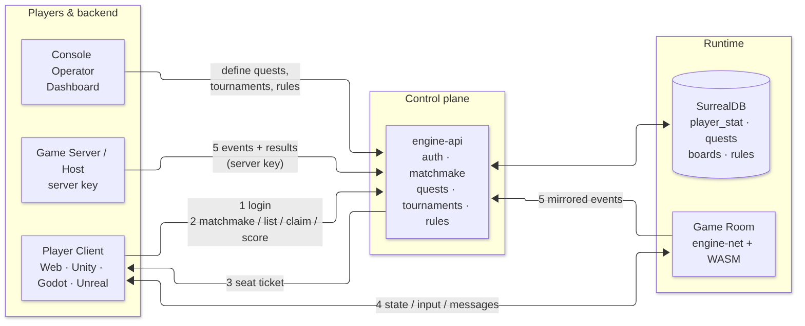
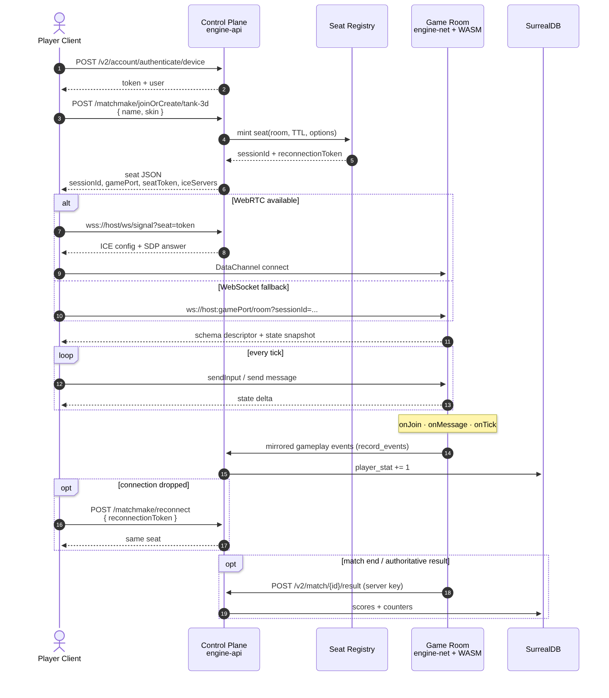
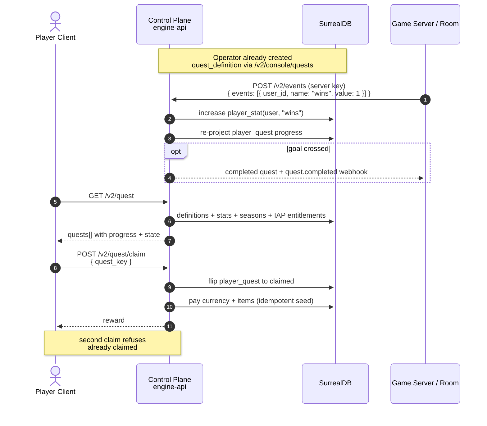
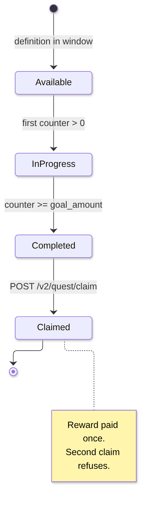
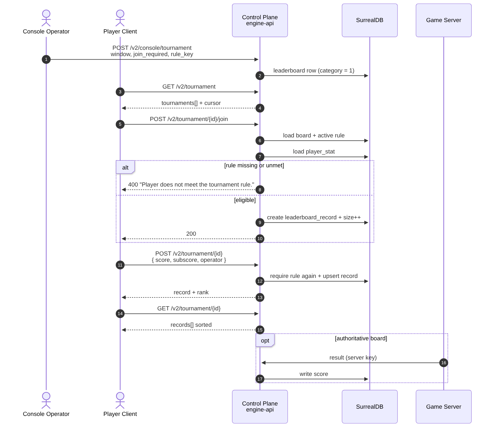
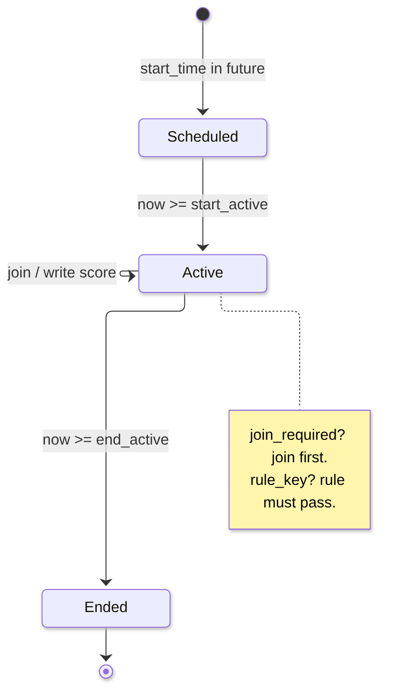

# CYG Game Flows — Diagrams

Ye folder normal match, quest, tournament aur rules ka flow samjhata hai.
Har diagram ka source `.mmd` hai, aur rendered `.svg` + `.png` bhi wahin hai.

| Diagram | File |
|---|---|
| Poora system ek nazar me | `overview.png` / `overview.svg` |
| Normal match (seat → room → state) | `match.png` / `match.svg` |
| Quest (event → progress → claim) | `quest.png` / `quest.svg` |
| Tournament (create → list → join → score) | `tournament.png` / `tournament.svg` |
| Quest state machine | `quest-state.png` / `quest-state.svg` |
| Tournament state machine | `tournament-state.png` / `tournament-state.svg` |

> Golden rule: **client progress/score khud nahi badhata**.
> Client sirf list/join/claim karta hai; asli counters aur scores
> **game server** server-key ke saath bhejta hai.

---

## 1. Overview — kaun kis se baat karta hai



Teen layers hain:

1. **Players & backend** — player client, console operator, game server/host.
2. **Control plane (`engine-api`)** — auth, matchmaking, quests, tournaments, rules.
3. **Runtime** — `engine-net` rooms (WASM host) aur SurrealDB.

Arrows ka matlab:

| Arrow | Matlab |
|---|---|
| `1 login` | player token leta hai (`/v2/account/authenticate/*`) |
| `2 matchmake / list / claim / score` | player HTTP calls |
| `3 seat ticket` | control plane seat JSON deta hai |
| `4 state / input / messages` | client room se realtime baat karta hai |
| `5 mirrored events` | room ke gameplay events control plane ko jaate hain |
| `5 events + results` | game server server-key se counters/scores bhejta hai |

Yaad rakho: **matchmaking sirf seat deta hai**. Asli khel room ke andar chalta hai.

---

## 2. Normal match



### Step-by-step

**Step 1 — login**

```http
POST /v2/account/authenticate/device
{ "device_id": "device-abc-123" }
```

Response me `token` aata hai. Aage har player call:

```http
Authorization: Bearer <player-token>
```

**Step 2 — matchmaking**

```http
POST /matchmake/joinOrCreate/tank-3d
Authorization: Bearer <player-token>
Content-Type: application/json

{ "name": "miya", "skin": "ninja" }
```

Methods:

| Method | Kaam |
|---|---|
| `joinOrCreate` | room hai to join, nahi hai to banao |
| `join` | sirf existing room |
| `create` | naya room |
| `joinById` | room id se |
| `spectate` | bina khele dekhna |
| `reconnect` | purani seat wapas |

**Step 3 — seat JSON**

```json
{
  "name": "tank-3d",
  "sessionId": "175...-17",
  "roomId": "tank-3d",
  "reconnectionToken": "dGFuay0zZA==....abc",
  "seatToken": "dGFuay0zZA==....abc",
  "gamePort": 7777,
  "controlPort": 8080,
  "udpPort": 7778,
  "expiresAt": 1760000000,
  "iceServers": "[...]"
}
```

Ye **seat** hi asli ticket hai. Server ne pehle hi tay kar diya kaunse room me baithna hai.

**Step 4 — connect**

WebRTC path:

```text
wss://<host>/ws/signal?seat=<reconnectionToken>
```

WebSocket fallback:

```text
ws://<host>:<gamePort>/<room>?sessionId=<sessionId>&options=<encoded-json>
```

**Step 5 — room ke andar**

```text
connect
  → onJoin(client, options)
  → schema descriptor
  → state snapshot / delta
  → sendInput / send message
  → onTick par state update
  → onLeave / reconnect
```

**Step 6 — match khatam**

- Quest ke liye: room/host `POST /v2/events` bhejta hai (server key).
- Authoritative result ke liye: `POST /v2/match/{id}/result` (server key).

Server key header player token nahi hota:

```http
Authorization: Basic base64("<server-key>:")
```

---

## 3. Quest



### Flow

```text
operator → POST /v2/console/quests        (definition)
server   → POST /v2/events                (counter badhao)
client   → GET /v2/quest                  (list + progress)
client   → POST /v2/quest/claim           (reward lo)
```

### Quest definition (console)

```http
POST /v2/console/quests
Authorization: Bearer <console-token>

{
  "quest_key": "win-3",
  "title": "Win 3 matches",
  "goal_kind": "wins",
  "goal_amount": 3,
  "reward": {
    "currency": { "gold": 50 },
    "items": [{ "item_id": "medal", "quantity": 2 }]
  }
}
```

`goal_kind` = counter ka naam. Event ka `name` isi se match karna chahiye.

### Progress (game server)

```http
POST /v2/events
Authorization: Basic base64("<server-key>:")

{
  "events": [
    { "user_id": "<player-uuid>", "name": "wins", "value": 1 }
  ]
}
```

Server:

1. `player_stat` me `wins` counter badhata hai.
2. `player_quest` progress re-project karta hai.
3. Goal cross ho to `quest.completed` webhook bhejta hai.

Room ke mirrored events bhi +1 dete hain, lekin sirf config me listed events:

```toml
[gameplay]
record_events = ["kill", "win", "match_end"]
```

### List (client)

```http
GET /v2/quest
Authorization: Bearer <player-token>
```

```json
{
  "quests": [
    {
      "quest_key": "win-3",
      "title": "Win 3 matches",
      "goal_kind": "wins",
      "goal_amount": 3,
      "progress": 1,
      "state": "in_progress",
      "reward": { "currency": { "gold": 50 }, "items": [] },
      "season": null,
      "requires_product": null,
      "active_from": "...",
      "active_to": "..."
    }
  ]
}
```

State machine:



| state | Matlab |
|---|---|
| `available` | abhi progress 0 |
| `in_progress` | progress hai, goal poora nahi |
| `completed` | goal poora, claim baaki |
| `claimed` | reward le liya |

### Claim

```http
POST /v2/quest/claim
Authorization: Bearer <player-token>

{ "quest_key": "win-3" }
```

Server pehle quest row flip karta hai, phir reward deta hai. Isliye double claim refuse hota hai.

Daily reward:

```http
POST /v2/account/daily/claim
```

### Quest caveats

- Quest window (`active_from` / `active_to`) aur season gating lagti hai.
- `requires_product` ho to active IAP subscription chahiye.
- Quest chains / auto-claim abhi nahi.
- Season ka `reward_track` sirf stored hai, auto-paid nahi.

---

## 4. Tournament



Tournament = time-window wala leaderboard. Bracket/knockout nahi.

### Operator create

```http
POST /v2/console/tournament
Authorization: Bearer <console-token>

{
  "id": "weekend-cup",
  "title": "Weekend Cup",
  "duration": 3600,
  "start_time": "2026-11-04T18:00:00Z",
  "join_required": true,
  "max_size": 1000,
  "max_num_score": 20,
  "authoritative": false,
  "rule_key": "ranked-eligibility"
}
```

| Field | Matlab |
|---|---|
| `duration` | round kitne seconds |
| `start_time` / `end_time` | window |
| `join_required` | pehle join zaroori? |
| `max_size` | kitne players |
| `max_num_score` | kitne score attempts |
| `authoritative` | sirf server-key writes |
| `rule_key` | eligibility rule |

### List

```http
GET /v2/tournament?limit=20
Authorization: Bearer <player-token>
```

```json
{
  "tournaments": [
    {
      "id": "weekend-cup",
      "title": "Weekend Cup",
      "size": 42,
      "max_size": 1000,
      "can_enter": true,
      "join_required": true,
      "rule_key": "ranked-eligibility"
    }
  ],
  "cursor": ""
}
```

### Join

```http
POST /v2/tournament/weekend-cup/join
Authorization: Bearer <player-token>
```

Server check karta hai:

```text
tournament exist?
window active?
size full?
rule_key hai?
  → active rule load
  → player_stat se compare
  → fail? 400 "Player does not meet the tournament rule."
```

Rule unpublished ho to bhi fail — fail closed.

### Score write

```http
POST /v2/tournament/weekend-cup
Authorization: Bearer <player-token>

{
  "score": 120,
  "subscore": 3,
  "metadata": "{\"mode\":\"solo\"}",
  "operator": 2
}
```

| operator | Matlab |
|---|---|
| 1 / best | best score |
| 2 / set | replace |
| 3 / increment | add |
| 4 / decrement | subtract |

Response me score string hota hai:

```json
{
  "leaderboard_id": "weekend-cup",
  "owner_id": "...",
  "score": "120",
  "rank": "3",
  "num_score": 1
}
```

### Leaderboard read

```http
GET /v2/tournament/weekend-cup?limit=10
```

```json
{
  "records": [
    { "owner_id": "...", "score": "900", "rank": "1" },
    { "owner_id": "...", "score": "700", "rank": "2" }
  ],
  "next_cursor": "..."
}
```

Aas-paas ka standing:

```http
GET /v2/tournament/weekend-cup/owner/<owner-uuid>
```

Apna record delete:

```http
DELETE /v2/tournament/weekend-cup
```

State machine:



### Authoritative board

`authoritative: true` par:

- player token se write → `403`
- sirf game server/server-key lane se score

### Reset

`reset_schedule` cron expression hai. Purani rows delete nahi hoti; window ke bahar read nahi hoti.

---

## 5. Listing cheat sheet

| Kya list karna | Endpoint |
|---|---|
| Live rooms | `GET /api/rooms` |
| Realtime match sessions | `GET /v2/match` |
| Quests + progress | `GET /v2/quest` |
| Tournaments | `GET /v2/tournament` |
| Tournament leaderboard | `GET /v2/tournament/{id}` |
| Apne aas-paas standing | `GET /v2/tournament/{id}/owner/{uid}` |
| Match history | `GET /v2/match/{id}/history` |
| Match events | `GET /v2/match/{id}/events` |
| Replay (console) | `GET /v2/console/match/{id}/replay` |

---

## 6. Kaun kya bhejta hai

| Kaun | Auth | Kya kar sakta hai |
|---|---|---|
| Player client | `Bearer <player-token>` | matchmake, quest list/claim, tournament list/join/score (non-authoritative), apna record delete |
| Game server | `Basic base64("<server-key>:")` | `POST /v2/events`, authoritative results, authoritative board writes |
| Console operator | `Bearer <console-token>` | quest/season/rules/tournament definitions, audit, rooms |

Client **kabhi** quest progress ya authoritative score khud nahi badha sakta.

---

## Regenerate diagrams

```bash
cd docs/flows
MMDC=<path-to-mmdc>
for f in overview match quest tournament quest-state tournament-state; do
  "$MMDC" -q -i "$f.mmd" -o "$f.svg" -p puppeteer.json -b white -t default
  "$MMDC" -q -i "$f.mmd" -o "$f.png" -p puppeteer.json -b white -t default -s 2
done
```
